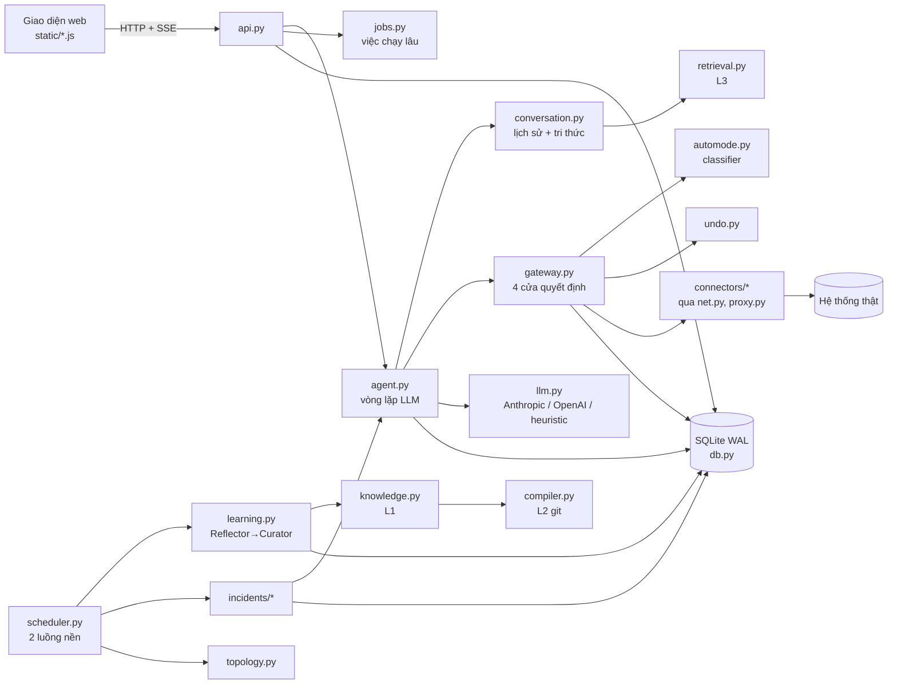

# Thiết kế hệ thống aiops

Tài liệu này mô tả hệ thống **như đang chạy**: thành phần, luồng chính, dữ liệu và các bất biến không được phá.
Chi tiết từng phần nằm ở tài liệu riêng (mục cuối). Lý do của từng quyết định và điểm khác thiết kế gốc nằm ở `docs/PLAN.md`;
thiết kế gốc là `Kiến trúc tích lũy tri thức tự động cho AI Agent.md`.

Tài liệu phải đúng với mã ở mọi commit. Quy tắc cập nhật ở `CLAUDE.md`, mục "Cập nhật tài liệu".

## 1. Tổng quan

aiops là agent vận hành hạ tầng cho nhiều team (tenant). Agent:

- trả lời và làm việc trong chat bằng công cụ thật (Kubernetes, Helm, OpenStack, Prometheus, Alertmanager, Grafana,
  Elasticsearch, GitLab, SQL, Web/HTTP);
- tự nhận cảnh báo, gom thành sự cố, điều tra chỉ đọc, đề xuất lệnh khắc phục;
- tự tích lũy tri thức từ lượt chat, tài liệu tải lên và sự cố đã xử lý xong, rồi dùng lại ở lượt sau.

Mọi lệnh gọi công cụ, của người hay của luồng nền, đi qua **một** cổng: `gateway.invoke`.



## 2. Mô hình chạy

| Khía cạnh | Thiết kế | Hệ quả |
|---|---|---|
| Tiến trình | Một tiến trình uvicorn, `--workers 1` | Lịch nền, khóa Compiler, bảng lượt đang chạy (`live.py`) và trạng thái trong bộ nhớ của sự cố đều nằm trong tiến trình. Không chạy nhiều worker. |
| Lưu trữ | SQLite WAL + FTS5 ở `AIOPS_DATA_DIR` (`/data` trong container); tri thức L2 là repo git riêng mỗi tenant trong `knowledge/` | Sao lưu bằng `sqlite3.backup()`, không `cp` file. |
| Luồng nền | `scheduler.py` có 2 luồng: vòng chính mỗi `AIOPS_SCHEDULER_INTERVAL` (60 s) và vòng cảnh báo mỗi 15 s | Vòng học gọi LLM lâu không làm trễ việc lấy cảnh báo. |
| Việc chạy lâu từ UI | `jobs.py`: luồng nền, trạng thái ở bảng `job`; request chờ tối đa vài giây rồi trả job để trang theo dõi | F5 hay người khác mở cùng trang vẫn thấy việc đang chạy. Mỗi (tenant, kind, target) chạy một lượt một lúc. `jobs.recover` đánh dấu việc dở dang khi khởi động lại. |
| Lượt chat | Chạy ở luồng riêng, sự kiện đẩy qua SSE; `live.py` giữ sự kiện của lượt đang chạy | Tải lại trang thì xem tiếp được; nút dừng đặt `StopFlag`. |
| Khởi động (`api.lifespan`) | `seed` → chuẩn hóa tên thực thể → tiếp tục tách tài liệu dở → `jobs.recover` → tiếp tục tổng hợp KU → bật scheduler | |

### Vòng nền

- **Vòng chính** (`scheduler.tick`): hết hạn phê duyệt, dọn kết quả công cụ cũ; với từng tenant: kiểm tra kho mỗi ngày
  (`lint`, rồi `dedup` ở luồng riêng), tách tài liệu nguồn, học khi đủ episode hoặc có thất bại rồi biên dịch L2.
- **Vòng cảnh báo** (`scheduler.alert_tick`): lấy cảnh báo và xử lý sự cố (`incidents.tick`), kiểm tra sau khi chạy lệnh ghi
  (`undo.tick`), quét topology khi cần (`topology.tick`, luồng riêng).

## 3. Đa tenant và quyền

- **Cấp bậc:** `org` → `tenant` (team) → `membership(tenant, user, role)`. Vai trò: `member`, `tenant_admin`, `approver:<env>`.
  `app_user.is_org_admin` là quản trị toàn tổ chức (LLM, proxy, cho phép mạng nội bộ, quota).
- **Cô lập:** mọi truy vấn lọc `tenant_id` ở tầng truy vấn (SQLite không có RLS). API kiểm tra thành viên trước khi đọc.
- **Overlay chính sách của tenant chỉ siết**, không nới: tự chạy → auto mode → hỏi → chặn.
- **Tài khoản bot** `aiops-alerts` của từng tenant chạy lệnh của luồng sự cố, vai trò `member`; mọi luật vẫn áp dụng.

## 4. Luồng một lượt chat

`api` (POST chat, SSE) → `agent.run_task`:

1. **Quota:** hết token quy đổi trong ngày thì dừng (`QuotaExceeded`), lượt chờ "Tiếp tục".
2. **Router** (model nhanh) xếp loại việc và thực thể.
3. **Lắp ngữ cảnh** (`conversation.py`):
   - system prompt cố định theo tenant (giữ prompt cache);
   - lịch sử phát lại nguyên văn, chỉ nối thêm, ngân sách `budget_history` 24k;
   - khối `<context>` của lượt: core, playbook, KU tìm được, sự cố liên quan; phần đã có trong lịch sử được bỏ.
4. **Vòng lặp model ↔ công cụ:** mỗi lệnh gọi qua `gateway.invoke`. Đọc chạy song song (tối đa `max_parallel_tools` = 8, overlay chỉ hạ; 4 lệnh cùng lúc mỗi kết nối), ghi chạy tuần tự.
   Agent có thêm `search_knowledge`, `read_knowledge_page`, `read_skill`, giao việc cho agent con chỉ đọc (`delegate`) và chạy nền.
   Kết quả lớn lưu ở server (`results.py`), context chỉ nhận `result_id` và bản xem trước, lọc bằng `data.*`.
5. **Lệnh cần duyệt:** lượt kết thúc với thẻ duyệt. Khi mọi lệnh chờ của lượt đã được quyết định, agent tự chạy một lượt tiếp với kết quả.
6. **Ghi episode** (L0, chỉ ghi thêm) và `llm_call` (token từng lần gọi).

## 5. Gateway: quyết định một lệnh

Chi tiết và ma trận đầy đủ ở `docs/TOOLS.md`, mục "Gateway quyết định thế nào". Tóm tắt thứ tự, dừng ở bước đầu tiên khớp:

1. Công cụ chưa đăng ký → chặn. Luật `deny`, ô `block` → chặn.
2. Bắt buộc hỏi: change freeze, quota ghi, chạy thử lỗi, `auto_execute`, lý do của luồng sự cố.
3. Ma trận rủi ro R0–R4 × môi trường dev/staging/prod (prod R2+ luôn cần người).
4. Ô auto mode: classifier (`automode.py`) xét theo **ý người dùng và các lệnh đã gọi**, không đọc kết quả công cụ hay lời agent.
5. Grant "cho phép trong 1 giờ".
6. Lệnh ghi tự chạy còn phải **hoàn tác được và đáng tin** (`undo.py`, module `connectors/*_undo.py`).

Mọi quyết định ghi `tool_call_audit`. Connector chỉ gọi mạng qua `net.py` (chống SSRF, ghim IP) và `proxy.py` (PAC).
Secret của kết nối mã hóa bằng khóa chủ `AIOPS_SECRET_KEY` để ngoài volume dữ liệu.

## 6. Tri thức: L0 → L3

| Lớp | Nội dung | Mã | Bảng |
|---|---|---|---|
| L0 | Episode: mỗi lượt, bất biến (trigger chặn sửa/xóa) | `agent.py` | `episode`, `conversation` |
| L1 | Knowledge unit (KU) nguyên tử, hai trục thời gian, mọi thay đổi ghi sự kiện để rollback | `knowledge.py`, `entities.py` | `knowledge_unit`, `ku_event`, `ku_edge`, `entity_alias` |
| L2 | Playbook, core, trang thực thể, Skill, dựng xác định từ KU active (LLM không viết playbook); repo git mỗi tenant, nhánh `proposal/*`, golden task chặn publish | `compiler.py` | `compile_run`, `golden_task`, `skill` |
| L3 | Truy xuất lai: lọc phạm vi/hiệu lực → vector băm + BM25 → mở rộng 1 bước theo `ku_edge` → xếp theo độ hữu ích | `retrieval.py` | `ku_fts` |

**Luồng học** (`learning.py`, chạy nền, agent không chờ): LLM-as-judge chấm episode chưa có kết quả → Reflector rút bài học →
Curator so với KU lân cận (thêm, sửa, bỏ) → cổng duyệt → Compiler.
Nguồn khác: tài liệu tải lên và sự cố đã xử lý (`sources.py`, `source_doc`), lệnh bị từ chối (`learn_from_denials`).
Bảo trì: `lint.py` (loại ứng viên quá hạn, gợi ý gộp thực thể), `dedup.py` (gộp KU trùng; nhóm có KU đang dùng chờ admin).
Công cụ học được: `learned.py`, mỗi bước vẫn qua gateway.

## 7. Sự cố

`incidents/*`, kế hoạch ở `docs/INCIDENTS-PLAN.md`, `docs/INCIDENTS-REFACTOR.md`.

```
ingest (Alertmanager/Prometheus, khử trùng theo fingerprint)
 → grouping (luật nhãn, quan hệ k8s, topology, rồi mới LLM)
 → investigate (agent chỉ đọc, luồng nền) → báo cáo + chuỗi 5 Whys + đề xuất lệnh
 → actions (lệnh qua gateway, độ tin thấp bị ép hỏi) → xác minh cảnh báo đã hết
 → summary, export (bản nháp issue/postmortem), notify (webhook), quality (chấm điều tra)
```

- Mức xử lý 1–3 (`rootcause.py`) và cách hiện (`present.py`) **tính lúc đọc**, không lưu: đổi luật không cần chạy lại dữ liệu.
- Dòng thời gian chỉ gồm lệnh đã chạy; dữ liệu ẩn lúc đọc, không xóa.
- Topology (`topology.py`, `docs/TOPOLOGY-PLAN.md`): thực thể và cạnh có thời hạn, mức tin theo cạnh, quét bằng công cụ đọc của kết nối dùng chung.

## 8. LLM

- Provider (`llm.py`): Anthropic (kể cả relay), OpenAI/tương thích OpenAI, và heuristic (không mạng, kết quả xác định, dùng cho test và khi chưa có key).
  Cấu hình chọn ở tab Cài đặt (`vault.py`, `llm_profile`), mã hóa khi lưu.
- Hai hạng model: mạnh (`AIOPS_MODEL_STRONG`) cho agent, Reflector, Curator, báo cáo; nhanh (`AIOPS_MODEL_FAST`) cho router, classifier, agent con.
- Mỗi lần gọi gắn mục đích (`agent`, `auto_mode`, `route`, `reflect`, `curate`, `incident_report`…) và ghi `llm_call`.
  Quota và chi phí tính bằng token quy đổi (cache read 0,1×, output 5×).

## 9. Dữ liệu

Schema ở `aiops/db.py`; migration chạy lúc khởi động, phải chạy lại được nhiều lần. Nhóm bảng:

| Nhóm | Bảng |
|---|---|
| Tổ chức, người dùng | `org`, `tenant`, `app_user`, `membership`, `session`, `user_profile` |
| Hội thoại, L0 | `conversation`, `episode`, `tool_result`, `llm_call` |
| Tri thức | `knowledge_unit`, `ku_fts`, `ku_edge`, `ku_event`, `entity_alias`, `ku_consolidation`, `ku_merge_proposal`, `ku_dedup_seen`, `ku_lint`, `source_doc`, `skill`, `compile_run`, `golden_task`, `learned_tool` |
| Công cụ, gateway | `connection`, `tool_registry`, `approval_request`, `approval_grant`, `tool_call_audit`, `change_record` (lệnh ghi chờ kiểm tra sau khi chạy), `undo_evidence` |
| Sự cố | `alert_event`, `incident`, `incident_event`, `incident_action`, `incident_task`, `investigation_review`, `incident_notice` |
| Topology | `topo_entity`, `topo_edge`, `topo_scan` |
| Cấu hình, khác | `app_setting`, `app_secret`, `llm_profile`, `job`; `sim_state` còn trong schema nhưng không mã nào dùng |

## 10. Giao diện

`aiops/static`: `index.html`, `app.js` (khung trang, các màn), `chat.js` (chat, thẻ duyệt), `style.css`. JS thuần, không bước build.
Nút gọi việc chạy lâu dùng `jobBtn`/`jobNote` trong `app.js` (theo dõi bảng `job`). Quy ước DOM ở `CLAUDE.md`, mục UI.

## 11. Triển khai

- `docker compose up -d --build`: image `aiops:local` từ `python:3.12-bookworm`, kèm kubectl, helm 3.19, helm-diff, helm-drift; volume `aiops-data`.
  Mạng nội bộ dùng mirror qua biến trong `.env` (gitignore).
- Hoặc `deploy/install.sh`: systemd service `aiops` sau Caddy (HTTPS).
- Healthcheck `/api/health`. API docs `/api/docs`.

## 12. Bất biến

Sửa mã mà phá một dòng dưới đây là đổi thiết kế, phải được chủ dự án đồng ý và ghi lại ở đây cùng `docs/PLAN.md`.

- Mọi lệnh công cụ đi qua `gateway.invoke`; công cụ chưa đăng ký bị chặn.
- Classifier của auto mode không đọc kết quả công cụ hay lời agent.
- Overlay của tenant chỉ siết. Prod R2+ luôn cần người.
- Lệnh ghi tự chạy phải có hoàn tác do code dựng từ snapshot, không do model viết.
- Episode chỉ ghi thêm. Thay đổi KU ghi `ku_event`.
- System prompt cố định theo tenant; lịch sử phát lại chỉ nối thêm. Đổi prompt hay danh sách công cụ làm mỗi tenant mất cache một lần.
- Playbook dựng xác định từ KU; golden task không được giảm (mốc 0,9).
- Agent con chỉ đọc. Luồng điều tra sự cố chỉ đọc.
- Một worker. Trạng thái cần sống qua F5 hay khởi động lại phải nằm trong DB.
- Không ghi IP, host, tên dịch vụ nội bộ vào file trong repo.

## 13. Tài liệu chi tiết

| Tài liệu | Nội dung |
|---|---|
| `README.md` | Chạy cục bộ, Docker, biến môi trường, bật LLM |
| `docs/PLAN.md` | Ánh xạ thiết kế gốc → mã, quyết định kỹ thuật và điểm khác thiết kế gốc |
| `docs/TOOLS.md` | Template, kết nối, gateway, hoàn tác, Kubernetes, Helm, OpenStack, thêm template mới |
| `docs/CONTEXT-PLAN.md` | Hội thoại, prompt cache, cách đưa tri thức vào lượt |
| `docs/INCIDENTS-PLAN.md`, `docs/INCIDENTS-REFACTOR.md` | Sự cố: kế hoạch, mô hình dữ liệu, module |
| `docs/TOPOLOGY-PLAN.md` | Topology nhiều tầng |
| `docs/IMPROVEMENTS.md` | Nhật ký cải tiến theo đợt |
