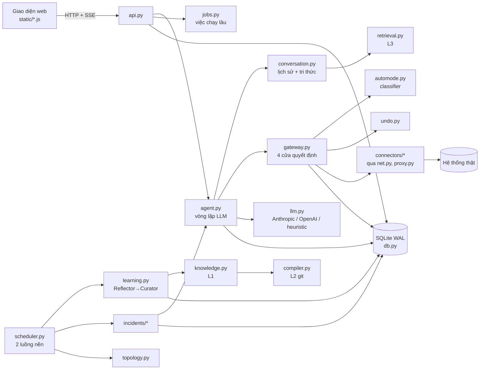
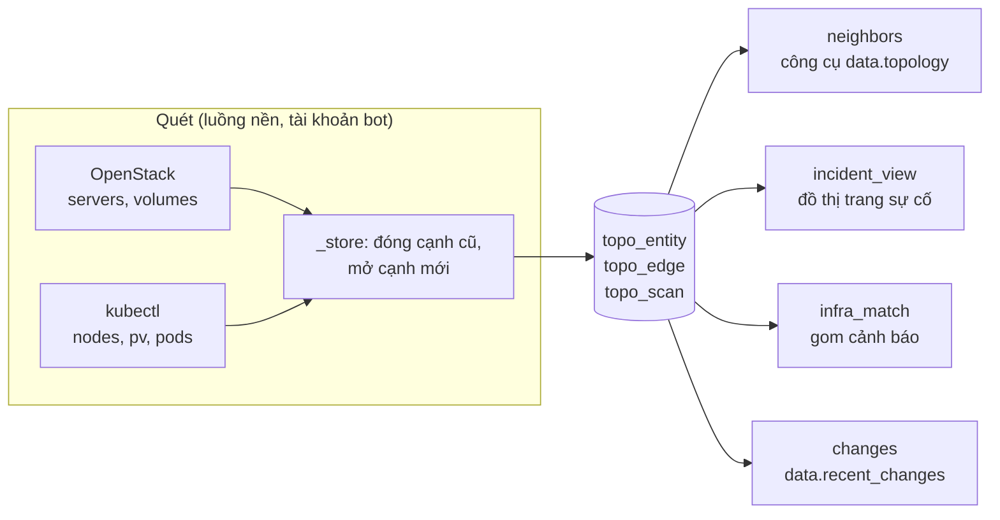

# Thiết kế hệ thống aiops

Tài liệu này mô tả hệ thống **như đang chạy**: thành phần, luồng chính, dữ liệu và các bất biến không được phá.
Chi tiết từng phần nằm ở tài liệu riêng (mục cuối). Lý do của từng quyết định và điểm khác thiết kế gốc nằm ở `docs/PLAN.md`;
thiết kế gốc là `Kiến trúc tích lũy tri thức tự động cho AI Agent.md`.

Tài liệu phải đúng với mã ở mọi commit. Quy tắc cập nhật ở `CLAUDE.md`, mục "Cập nhật tài liệu".

## 1. Tổng quan

aiops là agent vận hành hạ tầng cho nhiều team (tenant). Agent:

- trả lời và làm việc trong chat bằng công cụ thật (Kubernetes, Helm, OpenStack, Prometheus, Alertmanager, Grafana,
  Elasticsearch, GitLab, SQL, Web/HTTP);
- tự nhận cảnh báo, gom thành sự cố, điều tra chỉ đọc, đề xuất lệnh khắc phục;
- tự tích lũy tri thức từ lượt chat, tài liệu tải lên và sự cố đã xử lý xong, rồi dùng lại ở lượt sau.

Mọi lệnh gọi công cụ, của người hay của luồng nền, đi qua **một** cổng: `gateway.invoke`.



## 2. Mô hình chạy

| Khía cạnh | Thiết kế | Hệ quả |
|---|---|---|
| Tiến trình | Một tiến trình uvicorn, `--workers 1` | Lịch nền, khóa Compiler, bảng lượt đang chạy (`live.py`) và trạng thái trong bộ nhớ của sự cố đều nằm trong tiến trình. Không chạy nhiều worker. |
| Lưu trữ | SQLite WAL + FTS5 ở `AIOPS_DATA_DIR` (`/data` trong container); tri thức L2 là repo git riêng mỗi tenant trong `knowledge/` | Sao lưu bằng `sqlite3.backup()`, không `cp` file. |
| Luồng nền | `scheduler.py` có 2 luồng: vòng chính mỗi `AIOPS_SCHEDULER_INTERVAL` (60 s) và vòng cảnh báo mỗi 15 s | Vòng học gọi LLM lâu không làm trễ việc lấy cảnh báo. |
| Việc chạy lâu từ UI | `jobs.py`: luồng nền, trạng thái ở bảng `job`; request chờ tối đa vài giây rồi trả job để trang theo dõi | F5 hay người khác mở cùng trang vẫn thấy việc đang chạy. Mỗi (tenant, kind, target) chạy một lượt một lúc. `jobs.recover` đánh dấu việc dở dang khi khởi động lại. |
| Lượt chat | Chạy ở luồng riêng, sự kiện đẩy qua SSE; `live.py` giữ sự kiện của lượt đang chạy | Tải lại trang thì xem tiếp được; nút dừng đặt `StopFlag`. |
| Khởi động (`api.lifespan`) | `seed` → chuẩn hóa tên thực thể → tiếp tục tách tài liệu dở → `jobs.recover` → tiếp tục tổng hợp KU → bật scheduler | |

### Vòng nền

- **Vòng chính** (`scheduler.tick`): hết hạn phê duyệt, dọn kết quả công cụ cũ; với từng tenant: kiểm tra kho mỗi ngày
  (`lint`, rồi `dedup` ở luồng riêng), tách tài liệu nguồn, học khi đủ episode hoặc có thất bại rồi biên dịch L2.
- **Vòng cảnh báo** (`scheduler.alert_tick`): lấy cảnh báo và xử lý sự cố (`incidents.tick`), kiểm tra sau khi chạy lệnh ghi
  (`undo.tick`), quét topology khi cần (`topology.tick`, luồng riêng).

## 3. Đa tenant và quyền

- **Cấp bậc:** `org` → `tenant` (team) → `membership(tenant, user, role)`. Vai trò: `member`, `tenant_admin`, `approver:<env>`.
  `app_user.is_org_admin` là quản trị toàn tổ chức (LLM, proxy, cho phép mạng nội bộ, quota).
- **Cô lập:** mọi truy vấn lọc `tenant_id` ở tầng truy vấn (SQLite không có RLS). API kiểm tra thành viên trước khi đọc.
- **Overlay chính sách của tenant chỉ siết**, không nới: tự chạy → auto mode → hỏi → chặn.
- **Tài khoản bot** `aiops-alerts` của từng tenant chạy lệnh của luồng sự cố, vai trò `member`; mọi luật vẫn áp dụng.

## 4. Luồng một lượt chat

`api` (POST chat, SSE) → `agent.run_task`:

1. **Quota:** hết token quy đổi trong ngày thì dừng (`QuotaExceeded`), lượt chờ "Tiếp tục".
2. **Router** (model nhanh) xếp loại việc và thực thể.
3. **Lắp ngữ cảnh** (`conversation.py`):
   - system prompt cố định theo tenant (giữ prompt cache);
   - lịch sử phát lại nguyên văn, chỉ nối thêm, ngân sách `budget_history` 24k;
   - khối `<context>` của lượt: core, playbook, KU tìm được, sự cố liên quan; phần đã có trong lịch sử được bỏ.
     Kèm một dòng màn người dùng đang mở cạnh chat (`ChatBody.page`, `api._viewing`). Với sự cố, tiêu đề đọc từ DB, không lấy nhãn của client.
4. **Vòng lặp model ↔ công cụ:** mỗi lệnh gọi qua `gateway.invoke`. Đọc chạy song song (tối đa `max_parallel_tools` = 8, overlay chỉ hạ; 4 lệnh cùng lúc mỗi kết nối), ghi chạy tuần tự.
   Agent có thêm `search_knowledge`, `read_knowledge_page`, `read_skill`, giao việc cho agent con chỉ đọc (`delegate`) và chạy nền.
   Kết quả lớn lưu ở server (`results.py`), context chỉ nhận `result_id` và bản xem trước, lọc bằng `data.*`.
5. **Lệnh cần duyệt:** lượt kết thúc với thẻ duyệt. Khi mọi lệnh chờ của lượt đã được quyết định, agent tự chạy một lượt tiếp với kết quả.
6. **Ghi episode** (L0, chỉ ghi thêm) và `llm_call` (token từng lần gọi).

## 5. Gateway: quyết định một lệnh

Chi tiết và ma trận đầy đủ ở `docs/TOOLS.md`, mục "Gateway quyết định thế nào". Tóm tắt thứ tự, dừng ở bước đầu tiên khớp:

1. Công cụ chưa đăng ký → chặn. Luật `deny`, ô `block` → chặn.
2. Bắt buộc hỏi: change freeze, quota ghi, chạy thử lỗi, `auto_execute`, lý do của luồng sự cố.
3. Ma trận rủi ro R0–R4 × môi trường dev/staging/prod (prod R2+ luôn cần người).
4. Ô auto mode: classifier (`automode.py`) xét theo **ý người dùng và các lệnh đã gọi**, không đọc kết quả công cụ hay lời agent.
5. Grant "cho phép trong 1 giờ".
6. Lệnh ghi tự chạy còn phải **hoàn tác được và đáng tin** (`undo.py`, module `connectors/*_undo.py`).

Mọi quyết định ghi `tool_call_audit`. Connector chỉ gọi mạng qua `net.py` (chống SSRF, ghim IP) và `proxy.py` (PAC).
Secret của kết nối mã hóa bằng khóa chủ `AIOPS_SECRET_KEY` để ngoài volume dữ liệu.

## 6. Tri thức: L0 → L3

| Lớp | Nội dung | Mã | Bảng |
|---|---|---|---|
| L0 | Episode: mỗi lượt, bất biến (trigger chặn sửa/xóa) | `agent.py` | `episode`, `conversation` |
| L1 | Knowledge unit (KU) nguyên tử, hai trục thời gian, mọi thay đổi ghi sự kiện để rollback | `knowledge.py`, `entities.py` | `knowledge_unit`, `ku_event`, `ku_edge`, `entity_alias` |
| L2 | Playbook, core, trang thực thể, Skill, dựng xác định từ KU active (LLM không viết playbook); repo git mỗi tenant, nhánh `proposal/*`, golden task chặn publish | `compiler.py` | `compile_run`, `golden_task`, `skill` |
| L3 | Truy xuất lai: lọc phạm vi/hiệu lực → vector băm + BM25 → mở rộng 1 bước theo `ku_edge` → xếp theo độ hữu ích | `retrieval.py` | `ku_fts` |

**Luồng học** (`learning.py`, chạy nền, agent không chờ): LLM-as-judge chấm episode chưa có kết quả → Reflector rút bài học →
Curator so với KU lân cận (thêm, sửa, bỏ) → cổng duyệt → Compiler.
Nguồn khác: tài liệu tải lên và sự cố đã xử lý (`sources.py`, `source_doc`), lệnh bị từ chối (`learn_from_denials`).
Bảo trì: `lint.py` (loại ứng viên quá hạn, gợi ý gộp thực thể), `dedup.py` (gộp KU trùng; nhóm có KU đang dùng chờ admin).
Công cụ học được: `learned.py`, mỗi bước vẫn qua gateway.

## 7. Sự cố

`incidents/*`, kế hoạch ở `docs/INCIDENTS-PLAN.md`, `docs/INCIDENTS-REFACTOR.md`.

```
ingest (Alertmanager/Prometheus, khử trùng theo fingerprint)
 → grouping (luật nhãn, quan hệ k8s, topology, rồi mới LLM)
 → investigate (agent chỉ đọc, luồng nền) → báo cáo + chuỗi 5 Whys + đề xuất lệnh
 → actions (lệnh qua gateway, độ tin thấp bị ép hỏi) → xác minh cảnh báo đã hết
 → summary, export (bản nháp issue/postmortem), notify (webhook), quality (chấm điều tra)
```

- Mức xử lý 1–3 (`rootcause.py`) và cách hiện (`present.py`) **tính lúc đọc**, không lưu: đổi luật không cần chạy lại dữ liệu.
- Dòng thời gian chỉ gồm lệnh đã chạy; dữ liệu ẩn lúc đọc, không xóa.
- Topology dùng cho điều tra, đồ thị trang sự cố, khoanh vùng và gom cảnh báo: xem mục 8.

## 8. Topology

Mã ở `aiops/topology.py`; lý do và các giai đoạn ở `docs/TOPOLOGY-PLAN.md`. Đã làm giai đoạn A và B1–B3; B4 (màn Topology riêng), C, D chưa làm.

**Nguyên tắc:** topology đã lưu **không phải fact**. Mỗi cạnh có khoảng hiệu lực, mức tin tính theo từng cạnh tại thời điểm hỏi
(thường là lúc cảnh báo bắt đầu). Căn cứ của điều tra vẫn là bước đọc trực tiếp `S<n>` qua gateway; cạnh "gợi ý" kèm lệnh đọc lại.



### Mô hình dữ liệu

| Bảng | Cột chính | Ghi chú |
|---|---|---|
| `topo_entity` | `id`, `type`, `name`, `attrs` (JSON), `source` (tên kết nối), `first_seen`, `last_seen`, `gone_at` | Khóa `(tenant_id, id)`. Không mang mức tin. Biến mất thì đặt `gone_at`, không xóa, để còn điều tra sự cố cũ. |
| `topo_edge` | `src`, `rel`, `dst`, `how`, `source`, `valid_from`, `valid_to`, `last_seen` | `valid_to` NULL = đang đúng. Cạnh đổi thì đóng cạnh cũ, mở cạnh mới, không ghi đè. |
| `topo_scan` | `started_at`, `finished_at`, `reason`, `result` (JSON theo nguồn: số thực thể, cạnh mở/đóng, tầng bị bỏ qua) | Một dòng mỗi lần quét, ghi khi quét xong. |

Kiểu thực thể và khóa (tạm, đổi theo data model chung của nhóm Cloud Operations khi có):

| Kiểu | Khóa `id` | Tầng vẽ | Nguồn |
|---|---|---|---|
| `k8s.cluster` | `k8s.cluster:<kết nối>` | 0 Cluster | tên kết nối k8s |
| `k8s.pod` | `k8s.pod:<kết nối>/<ns>/<tên>` | 1 Pod | `get pods`, chỉ namespace của sự cố đang mở |
| `k8s.node`, `k8s.pvc` | `k8s.node:<kết nối>/<tên>`, `k8s.pvc:<kết nối>/<ns>/<tên>` | 2 | `get nodes`, `claimRef` của PV |
| `os.server`, `k8s.pv` | `os.server:<uuid>`, `k8s.pv:<kết nối>/<tên>` | 3 | `/servers/detail`, `get pv` |
| `os.volume` | `os.volume:<uuid>` | 4 | `/volumes/detail` |
| `os.hypervisor`, `os.backend` | `os.hypervisor:<host>`, `os.backend:<host>` | 5 Hạ tầng | trường admin của server và volume |
| `os.project` | `os.project:<id>` | không vẽ | `tenant_id` của server |

Quan hệ: `runs_on`, `uses` (đi xuống tầng dưới) và `member_of` (node → cluster, server → project).
`how` = `api` (tham chiếu thẳng trong dữ liệu API) hoặc `match` (suy ra từ IP trùng, luôn là gợi ý).

| Cạnh | Cách có | `how` |
|---|---|---|
| node → máy ảo | `spec.providerID` = `openstack:///<uuid>` và máy ảo đã có; không thì trùng InternalIP với IP của máy ảo | `api` / `match` |
| máy ảo → hypervisor | `OS-EXT-SRV-ATTR:hypervisor_hostname` (cần admin) | `api` |
| máy ảo → volume | `os-extended-volumes:volumes_attached`, `attachments` của volume | `api` |
| volume → backend | `os-vol-host-attr:host`, bỏ phần `#pool` (cần admin) | `api` |
| PV → volume | `spec.cinder.volumeID`, hoặc `csi.volumeHandle` khi driver là cinder | `api` |
| PVC → PV, pod → PVC, pod → node | `claimRef` của PV; `spec.volumes`, `spec.nodeName` của pod | `api` |

### Thu thập

- **Nguồn:** kết nối dùng chung (`scope='tenant'`), đang bật, template `k8s` hoặc `openstack`. OpenStack quét trước, vì cạnh node → máy ảo cần máy ảo đã có.
- **Cách gọi:** `gateway._execute` trực tiếp bằng tài khoản bot của tenant, mỗi lệnh ghi `tool_call_audit` với quyết định `system`.
  Không qua ma trận hay classifier vì chỉ dùng công cụ đọc (`api_read`, `kubectl_read`). Công cụ đó tắt thì nguồn báo lỗi, nguồn khác vẫn quét.
- **OpenStack:** `all_tenants=1`, phân trang bằng `marker`, 1000 bản ghi × tối đa 20 trang. Tầng hypervisor và backend là best effort:
  không thấy trường của admin thì ghi tầng đó "bỏ qua: không có quyền admin", các tầng khác vẫn dựng.
- **Kubernetes:** `get nodes`, `get pv` với `custom-columns`; pod chỉ quét cho tối đa 10 namespace của cảnh báo đang bắn thuộc sự cố đang mở.
- **Lịch** (`due`, gọi từ vòng cảnh báo 15 s): lần đầu; 6 giờ một lần (`FULL_HOURS`); hoặc có sự cố mở mới sau lần quét gần nhất
  mà lần đó đã cách ≥ 15 phút (`INCIDENT_MINUTES`). Mỗi tenant một luồng quét một lúc. Tenant admin bấm quét ngay ở tab Sự cố (`POST /api/topology/scan`).
- **Ghi** (`_store`, một giao dịch mỗi nguồn): thực thể upsert; cạnh giống thì cập nhật `last_seen`, khác thì đóng cũ mở mới.
  Chỉ loại thực thể **liệt kê đủ** (không bị cắt trang hay cắt output) mới bị đánh dấu `gone_at` khi vắng, kèm đóng mọi cạnh của nó.
- **An toàn:** tên không khớp `SAFE` (chữ tự do do người đặt) thì không lưu làm tên. Kết quả quét chỉ được code đọc, không đưa vào LLM.

### Mức tin của một cạnh tại thời điểm `t` (`trust`)

1. `how='match'` → gợi ý.
2. `valid_from > t` hoặc `valid_to ≤ t` → gợi ý (cạnh chưa có hoặc đã đổi lúc đó).
3. `last_seen` cách `t` trong ngưỡng của loại cạnh → **tin cậy**; quá ngưỡng → gợi ý.

| Cạnh | Ngưỡng (`TRUST_HOURS`) |
|---|---|
| pod → node, pod → PVC | 15 phút |
| node → máy ảo, PVC → PV, PV → volume | 24 giờ |
| máy ảo → host, máy ảo → volume, volume → backend | 7 giờ (chu kỳ quét + 1) |
| node → cluster, máy ảo → project | 7 ngày |
| loại khác | 1 giờ |

Chưa có cạnh nào hiệu lực tại `t` (chưa quét tới lúc đó) thì dùng cạnh đang mở, và bước 2 đánh dấu nó là gợi ý.
Cạnh gợi ý kèm lệnh đọc lại (`kubectl_read get node|pv|pvc …`, `api_read /servers/<id>`, `/volumes/<id>`).

### Ánh xạ cảnh báo → thực thể (`start_points`, tính lúc đọc)

Bỏ nhãn của exporter trước (`target_labels`), rồi thử theo thứ tự: nhãn `node` → `instance` (tên hoặc IP của node, rồi IP của máy ảo)
→ `persistentvolumeclaim` + `namespace` → `pod` + `namespace` (pod đã quét). Pod chưa quét thì trả lệnh `get pod -o wide` để agent tìm node.

### Dùng ở đâu

| Nơi | Hàm | Làm gì |
|---|---|---|
| Công cụ agent `data.topology` (đọc, chạy local) | `neighbors` | Từ nhãn cảnh báo hoặc `entity`, đi xuống tối đa 6 tầng tại `at`: chuỗi cạnh kèm mức tin, thực thể khác dùng chung host/backend/máy ảo (tối đa 20), lệnh `verify` (tối đa 10), tầng bị bỏ qua. Prompt điều tra sự cố gọi nó đầu tiên với `at` = lúc cảnh báo bắt đầu. |
| Công cụ `data.recent_changes` | `changes` | Thêm `topology_changes`: cạnh mở hay đóng trong khoảng thời gian (pod chuyển node, VM migrate, volume gắn lại), không tính lần đầu thấy thực thể. |
| Trang sự cố, thẻ Topology | `incident_view` (`GET /api/incidents/{id}/topology`) | Đồ thị theo tầng tại lúc cảnh báo đầu tiên bắt đầu: thực thể của cảnh báo, tầng dưới (5 bước), cluster; phần còn lại gộp thành nhóm có đếm; thực thể đang bị cảnh báo ở sự cố khác vẽ kèm đoạn nối. Vai trò nút: `suspect` > `alert` > `other_alert` > `common` > `path`, `aggregate`. Giao diện `topologyGraph` trong `app.js`. |
| Thẻ Mức độ | `blast` | Từ thực thể nghi gây lỗi đi ngược lên 5 tầng: đếm theo loại và số project, hiện là gợi ý cho người đánh giá S1–S4. |
| Gom cảnh báo (`incidents/grouping.py`) | `infra_match` | Phương thức `infra` ("tầng dưới chung", điểm 0,85): cùng thực thể, hoặc cùng tầng dưới **đặc hiệu**. Chạy sau luật nhãn và quan hệ k8s, trước AI. Tự gắn cảnh báo mới (`match`) và tự gộp sự cố (`auto_merge`) chỉ khi mọi cạnh trên đường nối tin cậy; có cạnh gợi ý thì chỉ thành gợi ý gộp (`suggestions`). Phương thức `topology` của grouping là quan hệ nhãn k8s (cùng node, cùng workload), không dùng module này. |
| Tab Sự cố, thẻ trạng thái | `last_scan`, `sources` (`GET /api/topology/status`) | Nguồn, lần quét gần nhất, tầng bị bỏ qua và vì sao, số thực thể theo loại. |

### Nghi gây lỗi và "đặc hiệu"

`suspects` chọn thực thể nghi gây lỗi, luôn ghi là "nghi" kèm lý do:

1. Mắt xích 5 Whys sâu nhất có bước căn cứ đọc tới một thực thể trong topology (`step_entities` nhận `api_read /servers|volumes/<id>`,
   `kubectl get|describe|top node|pv|pvc|pod …`).
2. Không có thì xét tầng dưới của thực thể bị cảnh báo, gần nhất trước. Chỉ xét tầng dưới mà từ 2 thực thể bị cảnh báo trở lên đi tới,
   hoặc có từ 2 thực thể cùng loại đang bị cảnh báo, hoặc chính nó đang có cảnh báo. Tầng đó phải **đặc hiệu** (`specific`): chính nó đang có cảnh báo, hoặc trong các thực thể cùng loại
   phụ thuộc vào nó (tới 5 tầng), từ 2 và từ 80% (`SPECIFIC_SHARE`) trở lên đang bị cảnh báo, tính cả cảnh báo ở sự cố khác đang mở.
   Dùng chung một backend hay host lớn là bình thường nên không đủ để nghi. Đường nối có cạnh gợi ý thì lý do ghi "cần kiểm chứng".

### Giới hạn hiện tại

Đây là khoảng trống chưa làm, không phải quyết định giữ nguyên:

- Chưa có khai tay, tầng vật lý (`dc.host`, `dc.rack`), quan hệ dịch vụ (`depends_on`), workload, khách hàng ↔ project.
- Chưa có màn Topology riêng (B4); chỉ có đồ thị trên trang sự cố và thẻ trạng thái quét.
- Pod chỉ quét theo namespace của sự cố đang mở; ngoài đó agent phải đọc trực tiếp.
- Ngưỡng `TRUST_HOURS` và `SPECIFIC_SHARE` chưa được người vận hành từng tầng xác nhận, chưa kiểm trên sự cố thật.
- Trạng thái "đang quét" giữ trong bộ nhớ. Khởi động lại giữa lần quét thì lần đó không ghi `topo_scan`, vòng sau tự quét lại.

## 9. LLM

- Provider (`llm.py`): Anthropic (kể cả relay), OpenAI/tương thích OpenAI, và heuristic (không mạng, kết quả xác định, dùng cho test và khi chưa có key).
  Cấu hình chọn ở tab Cài đặt (`vault.py`, `llm_profile`), mã hóa khi lưu.
- Hai hạng model: mạnh (`AIOPS_MODEL_STRONG`) cho agent, Reflector, Curator, báo cáo; nhanh (`AIOPS_MODEL_FAST`) cho router, classifier, agent con.
- Mỗi lần gọi gắn mục đích (`agent`, `auto_mode`, `route`, `reflect`, `curate`, `incident_report`…) và ghi `llm_call`.
  Quota và chi phí tính bằng token quy đổi (cache read 0,1×, output 5×).

## 10. Dữ liệu

Schema ở `aiops/db.py`; migration chạy lúc khởi động, phải chạy lại được nhiều lần. Nhóm bảng:

| Nhóm | Bảng |
|---|---|
| Tổ chức, người dùng | `org`, `tenant`, `app_user`, `membership`, `session`, `user_profile` |
| Hội thoại, L0 | `conversation`, `episode`, `tool_result`, `llm_call` |
| Tri thức | `knowledge_unit`, `ku_fts`, `ku_edge`, `ku_event`, `entity_alias`, `ku_consolidation`, `ku_merge_proposal`, `ku_dedup_seen`, `ku_lint`, `source_doc`, `skill`, `compile_run`, `golden_task`, `learned_tool` |
| Công cụ, gateway | `connection`, `tool_registry`, `approval_request`, `approval_grant`, `tool_call_audit`, `change_record` (lệnh ghi chờ kiểm tra sau khi chạy), `undo_evidence` |
| Sự cố | `alert_event`, `incident`, `incident_event`, `incident_action`, `incident_task`, `investigation_review`, `incident_notice` |
| Topology (mục 8) | `topo_entity`, `topo_edge`, `topo_scan` |
| Cấu hình, khác | `app_setting`, `app_secret`, `llm_profile`, `job`; `sim_state` còn trong schema nhưng không mã nào dùng |

## 11. Giao diện

`aiops/static`: `index.html`, `app.js` (khung trang, các màn), `chat.js` (chat, thẻ duyệt), `style.css`. JS thuần, không bước build.

Bố cục gồm dải điều hướng bên trái (mở rộng được), chat luôn có mặt, và khung làm việc bên phải cho màn đang mở (sự cố, tri thức, công cụ…).
Khi chỉ có chat, chat chiếm cả màn hình. Mở một màn thì chat thu thành cột 400px, thu gọn được. Dưới 1000px chat và khung làm việc thay nhau hiện.
`render()` chỉ dựng lại phần thay đổi: đổi màn dựng lại khung làm việc, đổi hội thoại dựng lại chat. Nhờ vậy lượt đang stream không mất khi xem màn khác.
`renderShell()` của các màn chỉ tải lại khung làm việc, `buildShell()` dựng lại cả trang.
URL: `#/t/<tenant>/chat[/<hội thoại>]`, hoặc `#/t/<tenant>/<màn>[/<sub>[/<sub2>]][?c=<hội thoại>]`.
Trang sự cố có 3 tab: Diễn biến / Nguyên nhân / Xử lý (`sub2`). Đầu trang, tóm tắt sự cố và nút "việc đang chờ" luôn hiện trên thanh tab.
Nút gọi việc chạy lâu dùng `jobBtn`/`jobNote` trong `app.js` (theo dõi bảng `job`). Quy ước DOM ở `CLAUDE.md`, mục UI.

## 12. Triển khai

- `docker compose up -d --build`: image `aiops:local` từ `python:3.12-bookworm`, kèm kubectl, helm 3.19, helm-diff, helm-drift; volume `aiops-data`.
  Mạng nội bộ dùng mirror qua biến trong `.env` (gitignore).
- Hoặc `deploy/install.sh`: systemd service `aiops` sau Caddy (HTTPS).
- Healthcheck `/api/health`. API docs `/api/docs`.

## 13. Bất biến

Sửa mã mà phá một dòng dưới đây là đổi thiết kế, phải được chủ dự án đồng ý và ghi lại ở đây cùng `docs/PLAN.md`.

- Mọi lệnh công cụ đi qua `gateway.invoke`; công cụ chưa đăng ký bị chặn.
- Classifier của auto mode không đọc kết quả công cụ hay lời agent.
- Overlay của tenant chỉ siết. Prod R2+ luôn cần người.
- Lệnh ghi tự chạy phải có hoàn tác do code dựng từ snapshot, không do model viết.
- Episode chỉ ghi thêm. Thay đổi KU ghi `ku_event`.
- System prompt cố định theo tenant; lịch sử phát lại chỉ nối thêm. Đổi prompt hay danh sách công cụ làm mỗi tenant mất cache một lần.
- Playbook dựng xác định từ KU; golden task không được giảm (mốc 0,9).
- Agent con chỉ đọc. Luồng điều tra sự cố chỉ đọc.
- Một worker. Trạng thái cần sống qua F5 hay khởi động lại phải nằm trong DB.
- Không ghi IP, host, tên dịch vụ nội bộ vào file trong repo.

## 14. Tài liệu chi tiết

| Tài liệu | Nội dung |
|---|---|
| `README.md` | Chạy cục bộ, Docker, biến môi trường, bật LLM |
| `docs/PLAN.md` | Ánh xạ thiết kế gốc → mã, quyết định kỹ thuật và điểm khác thiết kế gốc |
| `docs/TOOLS.md` | Template, kết nối, gateway, hoàn tác, Kubernetes, Helm, OpenStack, thêm template mới |
| `docs/CONTEXT-PLAN.md` | Hội thoại, prompt cache, cách đưa tri thức vào lượt |
| `docs/INCIDENTS-PLAN.md`, `docs/INCIDENTS-REFACTOR.md` | Sự cố: kế hoạch, mô hình dữ liệu, module |
| `docs/TOPOLOGY-PLAN.md` | Topology nhiều tầng |
| `docs/IMPROVEMENTS.md` | Nhật ký cải tiến theo đợt |
